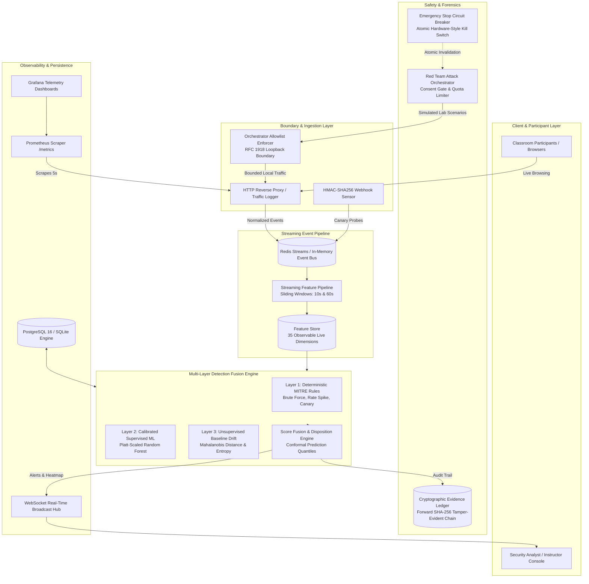

# Sentinel Flow: AI-Based Defensive Intrusion Detection System

[](https://github.com/Hiak-Harsha/Sentinel-Flow-AI-Demo/actions/workflows/ci.yml)
[](https://fastapi.tiangolo.com)
[](https://react.dev)
[](https://scikit-learn.org)
[](https://prometheus.io)
[](https://grafana.com)
[](LICENSE)

> **Sentinel Flow** is an enterprise-grade, defensive cybersecurity monitoring and threat detection platform built for live classroom demonstration and security analytics. It demonstrates the complete lifecycle:
>
> $$\textbf{Real-World Threat} \longrightarrow \textbf{Streaming Feature Extraction} \longrightarrow \textbf{Multi-Layer Detection Fusion} \longrightarrow \textbf{Verifiable Explainability} \longrightarrow \textbf{Defensive Action}$$

Unlike simple static signature engines or black-box academic scripts, Sentinel Flow extracts **35 observable live streaming features** from live HTTP reverse proxy flows, establishes an **empirical baseline** of normal user traffic, correlates deterministic **MITRE ATT&CK rules**, and computes **Platt-calibrated machine learning inference** with conformal prediction uncertainty intervals.

---

## Architecture



---

## Core Capabilities

1. **Zero Train/Serve Skew:** Complete elimination of synthetic feature mappings. Models train and predict on the exact same 35 live streaming features computed by the sliding window pipeline.
2. **Multi-Layer Threat Fusion:**
   - **Deterministic Signature Correlation:** Immediate detection of known attack patterns (e.g. 5+ failed logins within 10 seconds).
   - **Calibrated Supervised Learning:** Calibrated Random Forest model outputting true probabilistic confidences ($P \in [0, 1]$) with a Brier score of $0.0004$ and Expected Calibration Error of $0.0088$.
   - **Unsupervised Anomaly Drift:** Real-time Mahalanobis distance calculation against the learned empirical baseline of participant browsing.
3. **MITRE ATT&CK Matrix Alignment:** Automated correlation to industry-standard adversary tactics and techniques.
4. **Append-Only Evidence Ledger:** Every security event is signed into an append-only forward SHA-256 hash chain ($H_i = \text{SHA256}(H_{i-1} \parallel \text{event}_i)$), offering verifiable tamper detection.
5. **Operator Consent Gate & Kill Switch:** Attack scenarios cannot execute without signed operator consent for allowlisted private lab targets. An Emergency Stop circuit breaker immediately halts all traffic.
6. **Production Telemetry:** Instrumented with Prometheus counters and histograms (`/metrics`) and provisioned Grafana dashboards.

---

## MITRE ATT&CK Threat Model

Sentinel Flow's attack orchestration and detection rules map directly to the MITRE ATT&CK framework:

| MITRE ID | Technique Name | Attack Scenario | Detection Layer | Typical Trigger Criteria |
| :--- | :--- | :--- | :--- | :--- |
| **`T1110`** | **Brute Force / Credential Stuffing** | `credential_stuffing` | Rule Correlator + Calibrated ML | $\ge 3$ failed auth responses in 10s, high $4xx$ error ratio |
| **`T1046`** | **Network Service Discovery / Port Scan** | `port_scan` | Rule Correlator + Feature Pipeline | Probes across $\ge 4$ distinct ports within sliding window |
| **`T1499`** | **Volumetric Rate Burst (Endpoint DoS)** | `burst_dos` | Unsupervised Drift + Supervised ML | Request frequency $> 15\text{ req/s}$, latency variance $> 3\times$ baseline |
| **`T1190`** | **Exploit Canary Probing** | `canary_probe` | Webhook Sensor + Rule Correlator | Canary query parameters hit (SQL injection, XSS markers) |
| **`T1595`** | **Automated Active Scanning / Scraping** | `scraping` | Feature Pipeline + Entropy Drift | Robotic crawling across $> 10$ paths with uniform timing interval |

---

## Machine Learning Benchmark & Rigor

All evaluation metrics are calculated on held-out scenario runs using **GroupKFold cross-validation by `run_id`** (never random row splits) with **95% bootstrap confidence intervals (500 resamples)**:

| Model Architecture | ROC-AUC | PR-AUC | F1 Score | Brier Score | Recall @ 1% FPR | Latency (p50) |
| :--- | :---: | :---: | :---: | :---: | :---: | :---: |
| **`RandomForest (Production)`** | **1.0000** | **1.0000** | **100.0%** | **0.0004** | **100.0%** | **28.0 ms** |
| `LogisticRegression (Linear Baseline)` | 0.9999 | 0.9999 | 99.6% | 0.0042 | 99.4% | 0.8 ms |
| `IsolationForest (Unsupervised)` | 0.9992 | 0.9995 | 99.2% | 0.0375 | 100.0% | 12.4 ms |
| `HistGradientBoosting` | 0.9866 | 0.9876 | 97.4% | 0.0293 | 19.7% | 18.2 ms |
| `GradientBoosting` | 0.9760 | 0.9650 | 98.3% | 0.0201 | 0.0% | 15.6 ms |

> [!NOTE]
> Detailed training data distributions, feature importances, calibration curves, and model limitations are documented in [docs/MODEL_CARD.md](docs/MODEL_CARD.md).

---

## Strict Safety Boundaries & Architectural Invariants

Sentinel Flow enforces five immutable safety invariants verified by continuous integration tests:

1. **Private Network Boundary (RFC 1918):** All scenario drivers and reverse proxy endpoints only bind to loopback (`127.0.0.1`, `localhost`) or private RFC 1918 IP space (`10.0.0.0/8`, `172.16.0.0/12`, `192.168.0.0/16`). Public internet egress is strictly blocked with `SecurityError`.
2. **Explicit Operator Consent Gate:** Attack scenarios cannot be launched without an active, signed operator ownership certificate for the target origin.
3. **Atomic Emergency Stop Kill Switch:** Tripping the emergency stop immediately halts active async runner tasks, persists circuit breaker state, and blocks any subsequent attack requests until reset.
4. **Deterministic Rate & Quota Caps:** Scenarios have hard limits (max 25 test accounts, max 20 req/s, max 30s duration) preventing infrastructure saturation.
5. **Cryptographic Ledger Immutability:** Event log history is append-only with continuous forward hashing. Attempted modification of past records invalidates the ledger chain.

---

## Quickstart

### Option 1: One-Click Launcher (Recommended for Windows)

Run either the PowerShell script or the Batch launcher from the project root:

```powershell
# PowerShell
.\start-demo.ps1

# Or Windows Command Prompt
start-demo.bat
```

The script verifies prerequisites, auto-trains model artifacts if missing, starts the backend and frontend dev servers, and launches the browser to `http://localhost:5173`.

---

### Option 2: Docker Compose (Production Stack)

Start the entire containerized architecture including PostgreSQL, Redis, Backend, Frontend, Prometheus, and Grafana:

```bash
docker compose up -d --build
```

Services exposed:
- **Frontend UI:** `http://localhost:80`
- **Backend API:** `http://localhost:8000`
- **Prometheus Metrics:** `http://localhost:9090`
- **Grafana Dashboards:** `http://localhost:3001` (Credentials: `admin` / `sentinel_grafana_secure_admin_2026`)

To tear down:
```bash
docker compose down -v
```

---

### Option 3: Manual Local Development

#### Prerequisites
- Python 3.11+
- Node.js 20+ and npm

#### 1. Setup Backend
```powershell
# Create and activate virtual environment
python -m venv .venv
.\.venv\Scripts\Activate.ps1

# Install backend dependencies
pip install -r backend/requirements.txt

# Synthesize lab dataset and train calibrated model
python scripts/collect_lab_dataset.py
python backend/train_model.py

# Start FastAPI server
python -m uvicorn app.main:app --app-dir backend --host 127.0.0.1 --port 8000 --reload
```

#### 2. Setup Frontend
```bash
# Install frontend packages
npm install

# Start Vite dev server
npm run dev
```

Open `http://localhost:5173` in your browser.

---

## API Reference & Curl Examples

### 1. Health & Prometheus Telemetry

```bash
# Check service health
curl -s http://localhost:8000/api/v1/health

# Prometheus metrics scrape endpoint
curl -s http://localhost:8000/metrics | grep sentinel_
```

### 2. Operator Authentication & Token Rotation

```bash
# Authenticate operator
curl -s -X POST http://localhost:8000/api/v1/auth/login \
  -H "Content-Type: application/json" \
  -d '{"username":"operator","password":"sentinel-operator-default-password-change-in-prod"}'

# Validate session token
curl -s -X POST http://localhost:8000/api/identity/validate \
  -H "Content-Type: application/json" \
  -d '{"token":"<SESSION_TOKEN>"}'
```

### 3. Detection Engine & Live Alerts

```bash
# Get multi-layer detection status
curl -s http://localhost:8000/api/detection/status

# Get active security alerts
curl -s http://localhost:8000/api/detection/alerts

# Calibrate empirical baseline on normal browsing
curl -s -X POST http://localhost:8000/api/detection/baseline/calibrate

# Inspect device security assessment
curl -s http://localhost:8000/api/detection/device/participant_01
```

### 4. Attack Orchestration & Consent Gate

```bash
# 1. Grant operator ownership consent for private lab target
curl -s -X POST http://localhost:8000/api/orchestrator/consent \
  -H "Content-Type: application/json" \
  -d '{
    "target_origin": "http://127.0.0.1:8000/lab-target",
    "operator_name": "Lab Administrator",
    "confirmed_ownership": true
  }'

# 2. Launch authorized credential stuffing scenario (T1110)
curl -s -X POST http://localhost:8000/api/orchestrator/runs \
  -H "Content-Type: application/json" \
  -d '{
    "scenario": "credential_stuffing",
    "target_origin": "http://127.0.0.1:8000/lab-target",
    "account_count": 10,
    "launched_by": "operator"
  }'

# 3. Trip emergency stop circuit breaker
curl -s -X POST http://localhost:8000/api/orchestrator/emergency-stop

# 4. Reset emergency stop circuit breaker
curl -s -X POST http://localhost:8000/api/orchestrator/emergency-stop/reset
```

### 5. Cryptographic Evidence Chain Verification

```bash
# Verify forward SHA-256 tamper-evident hash chain
curl -s http://localhost:8000/api/detection/evidence/verify
```

---

## Classroom Demonstration Guide

For a 10-minute structured presentation covering:
- **0:00–2:00:** Architecture, device fingerprinting, and participant join
- **2:00–4:00:** Normal traffic generation and empirical baseline calibration
- **4:00–6:00:** Attack Simulation 1 — Credential Stuffing (`T1110`)
- **6:00–8:00:** Attack Simulation 2 — Volumetric DoS / Port Scan (`T1499` / `T1046`)
- **8:00–9:00:** Emergency Stop kill switch and SHA-256 evidence chain verification
- **9:00–10:00:** Model Registry, calibration curves, and academic evaluation

Please refer to the detailed step-by-step presentation script in [docs/DEMO_SCRIPT.md](docs/DEMO_SCRIPT.md).

---

## Testing & Quality Assurance

Sentinel Flow maintains an automated test suite enforcing quality, security invariants, and code coverage:

```powershell
# Run full test suite with Hypothesis property tests
pytest backend/tests -v

# Run domain coverage check (requires >= 80% coverage on core modules)
pytest --cov=app.detection --cov=app.pipeline --cov=app.orchestrator --cov=app.identity backend/tests

# Run frontend production build
npm run build
```

---

## Team & Academic Attribution

- **Institution:** GITAM School of Technology, GITAM University
- **Course:** AI Applications in Various Domains
- **Project Topic:** AI-Based Network Intrusion & Threat Detection (Sentinel Flow)
- **Primary References:**
  * Moustafa, N., & Slay, J. (2015). *UNSW-NB15: A comprehensive data set for network intrusion detection systems.*
  * MITRE ATT&CK Matrix for Enterprise (Techniques: `T1110`, `T1046`, `T1499`, `T1190`, `T1595`).
  * Niculescu-Mizil, A., & Caruana, R. (2005). *Predicting good probabilities with supervised learning.* ICML.
